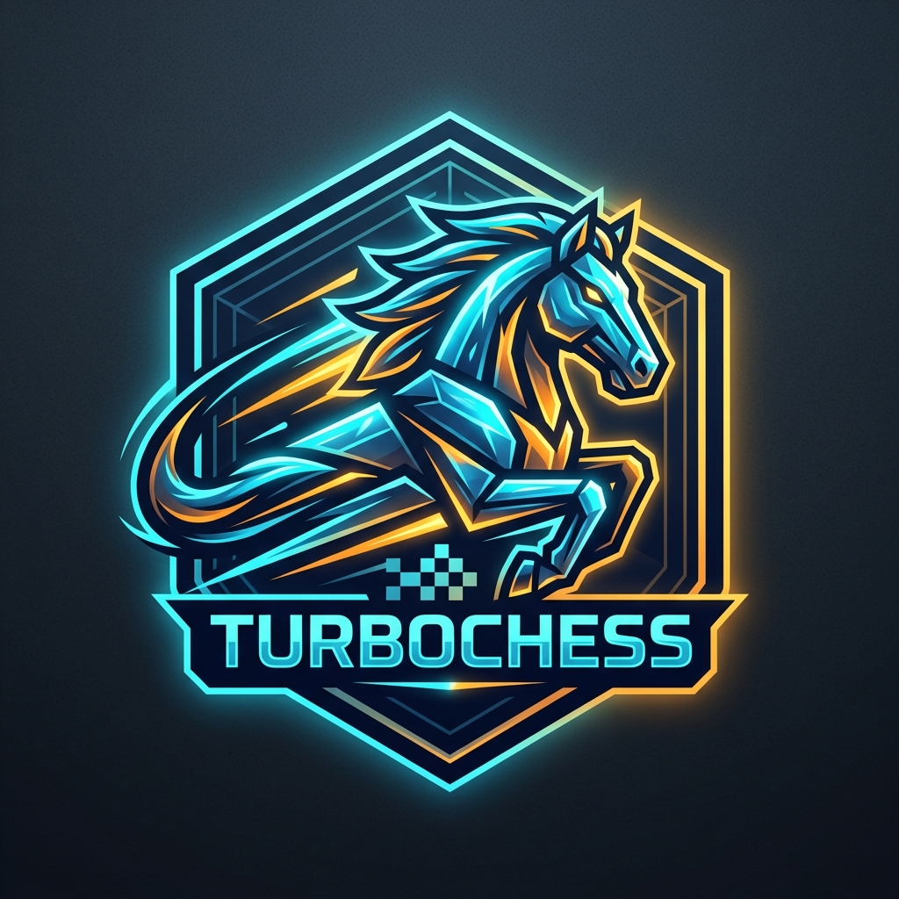
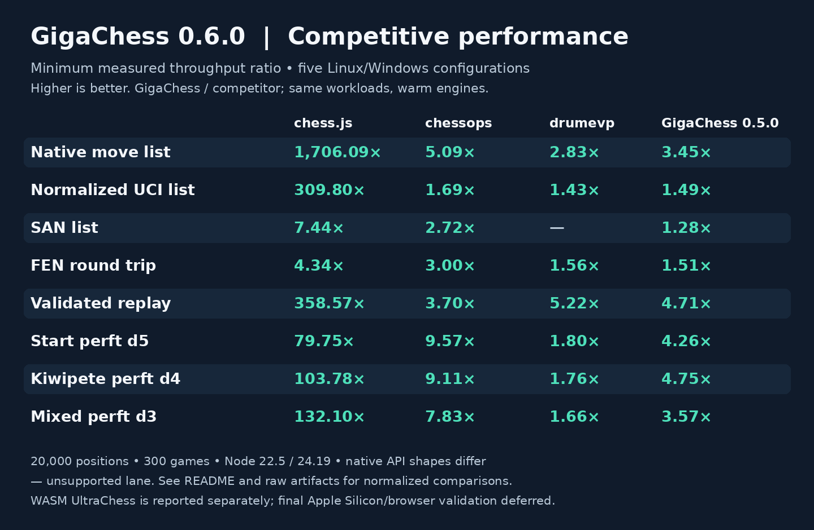

<p align="center">
  
</p>

<h1 align="center">GigaChess</h1>

<p align="center">
  <strong>The fastest pure JavaScript/TypeScript chess library in our benchmarks.</strong>
  <br>Up to 164× the perft throughput of chess.js and 13× that of chessops.<br>
  Full chess rules. Zero runtime dependencies. No WebAssembly.
</p>

<p align="center">
  <a href="https://github.com/itshak/gigachess/actions/workflows/ci.yml"></a>
  <a href="https://www.npmjs.com/package/gigachess"></a>
  <a href="https://bundlephobia.com/package/gigachess"></a>
  <a href="./LICENSE"></a>
  <a href="https://www.typescriptlang.org/"></a>
</p>

---

## Built to be the fastest

GigaChess 0.6.0 leads every supported pure-JS workload in our independent
Linux and Windows benchmark matrix, including move generation, notation,
FEN, game replay and perft. It is built for chess applications, interactive
boards, analysis tools and high-throughput game databases.

| Benchmark | vs chess.js | vs chessops |
|---|---:|---:|
| Mixed-position perft | **132–164×** | **7.8–9.9×** |
| Starting-position perft (depth 5) | **80–104×** | **9.6–13.4×** |
| SAN move lists | **7.4–8.1×** | **2.7–3.1×** |
| FEN round trip | **4.3–6.3×** | **3.0–3.8×** |

Throughput ratios across five tested Node.js configurations; higher is better.
Perft measures legal move-tree traversal, not AI search strength.
[Full results, all competitors and methodology](#performance-comparisons-060).

- **Pure TypeScript, zero runtime dependencies:** no WASM, native binaries or compilation step to begin playing.
- **Complete chess rules:** standard chess, Chess960, SAN, UCI, FEN, PGN and annotated study trees.
- **Developer-friendly:** familiar chess.js and chessops compatibility entry points, plus a high-throughput stateful Board API.
- **Compact and correct:** independent packed 16-bit moves, checked replay, incremental Polyglot hashes, FIDE repetition keys and reversible moves.
- **MIT licensed:** use in open-source or commercial projects.

### Optimized pure-JavaScript Board

The optional `gigachess/fast` entry delivers an independently minified ESM
Board with the same public rules and move encoding. Load the compact attack
and hash tables for peak throughput:

~~~ts
import { Board, ensureMagicTablesLoaded, ensureZobristLoaded } from "gigachess/fast";
await Promise.all([ensureMagicTablesLoaded(), ensureZobristLoaded()]);
const board = new Board();
~~~

Import the table-loading hooks from the SAME /fast entry: the ordinary
/core module has separate module-local caches. Specialized perft uses its
own reversible, clock-independent internal move path; makeMove/unmakeMove
still fully maintain Zobrist, castling, clocks, and move validation.
Both entry points work without awaiting attack tables; the synchronous fallback is exact. Await hash readiness before using Polyglot keys.

## 📦 Installation

```bash
npm install gigachess
```

---

## 🚀 Quick Start

```ts
import { Board } from "gigachess";

// Initialize starting position
const board = new Board();

// Parse SAN and execute a legal move
const move = board.parseSan("e4");
const undo = board.makeMove(move);

console.log(board.toFen());    // 'rnbqkbnr/pppppppp/8/8/4P3/8/PPPP1PPP/RNBQKBNR b KQkq - 0 1'
console.log(board.inCheck());  // false

// Instant O(1) reversible unmake
board.unmakeMove(undo);
console.log(board.toFen());    // startpos restored
```

---

## Performance comparisons (0.6.0)



Minimum GigaChess throughput advantage over each competitor across five Linux/Windows Node.js configurations. The strongest tested pure-JS competitor, drumevp, is also included: GigaChess is 2.33–3.73× faster in the separate direct move-generation comparison. See the [full benchmark report](docs/BENCHMARKS.md) for ranges, exact workloads, pinned versions and raw measurements.

| Workload | chess.js 1.4.0 | chessops 0.15.1 | drumevp 1.3.2 | drumevp source | GigaChess 0.5.0 |
|---|---:|---:|---:|---:|---:|
| Native move list | 1,706.09× | 5.09× | 2.83× | 2.79× | 3.45× |
| Normalized UCI list | 309.80× | 1.69× | 1.43× | 1.35× | 1.49× |
| SAN list | 7.44× | 2.72× | — | — | 1.28× |
| FEN round trip | 4.34× | 3.00× | 1.56× | — | 1.51× |
| Validated UCI replay | 358.57× | 3.70× | 5.22× | — | 4.71× |
| Start perft d5 | 79.75× | 9.57× | 1.80× | 1.81× | 4.26× |
| Kiwipete perft d4 | 103.78× | 9.11× | 1.76× | 1.75× | 4.75× |
| Endgame perft d5 | 45.86× | 7.60× | 1.35× | 1.37× | 4.79× |
| Promotion perft d4 | 90.96× | 8.71× | 1.64× | 1.65× | 4.39× |
| Mixed perft d3 | 132.10× | 7.83× | 1.66× | 1.63× | 3.57× |

The native list workload uses each library's public return type (chess.js produces verbose move objects); normalized UCI and SAN are separate. — means unsupported/not measured. 20,000 positions, 300 validated games, exact move-set and SAN parity. Final Apple Silicon/browser performance remains unverified.

### WebAssembly comparison

UltraChess (Rust/WASM) is a separate runtime category, not part of the
pure-JS ranking. Its warm perft throughput is higher, while GigaChess leads
validated replay and offers synchronous first-use without WASM initialization.
See the [separate warm and cold-start comparisons](docs/BENCHMARKS.md#ultrachess-rustwebassembly-separate-category).

---

## 🔄 Drop-in `chess.js` Compatibility

For supported `chess.js` APIs, switch the import:

```ts
// Simply replace your import:
// import { Chess } from "chess.js";
import { Chess } from "gigachess/chessjs";

const chess = new Chess();
chess.move("e4");
chess.move("e5");
console.log(chess.fen());     // 'rnbqkbnr/pppp1ppp/8/4p3/4P3/8/PPPP1PPP/RNBQKBNR w KQkq - 0 2'
console.log(chess.history()); // ['e4', 'e5']
```

---

## 💡 Common Recipes

### 1. Legal Move Generation
```ts
import { Board } from "gigachess";

const board = new Board();

// Iterate without array allocation:
board.forEachLegalMove((move) => {
  console.log(board.toSan(move));
});

// Or write into a reusable caller-owned buffer:
const buffer = new Uint16Array(256);
const count = board.legalMoves(buffer);
```

### 2. Game State & Terminal Checks
```ts
const board = new Board();

board.inCheck();               // false
board.isCheckmate();           // false
board.isStalemate();           // false
board.isDraw();                // false
board.isInsufficientMaterial();// false
board.turn;                    // 0 = White, 1 = Black
```

### 3. Incremental Polyglot Zobrist Hashing
```ts
import { Board, ensureZobristLoaded, repetitionKey } from "gigachess";

// The compact Zobrist data is loaded on demand; no wait is needed for normal
// movegen, but await readiness before asking for a meaningful position key.
await ensureZobristLoaded();
const board = new Board();

// Fast 64-bit Polyglot key updated in O(1) during moves:
const hash = board.zobrist(); // { lo: number, hi: number }
console.log(board.zobristHex()); // "463b96181691fc9c"

// FIDE repetition equivalence ignores en-passant when the capture is illegal.
// Polyglot hashing intentionally retains its pseudo-legal EP rule; don't
// substitute the repetition key in opening-book or interoperable database keys.
const fideKey = repetitionKey(board.pos);
```

### 4. Chess960 (Fischer Random)
```ts
import { Board } from "gigachess";

// Load any of the 960 starting positions:
const board = Board.fromFen("rnqbbknr/pppppppp/8/8/8/8/PPPPPPPP/RNQBBKNR w KQkq - 0 1", { chess960: true });
console.log(board.toFen());
```

### 5. Binary Move Stream Replay (`moves2`)
```ts
import { Board } from "gigachess";

// Replay full games from compact 16-bit buffers:
const moves = new Uint16Array([ /* packed 16-bit moves */ ]);
const board = Board.fromMoves2(moves); // trusted, already-validated data

// Files, network input and imported bytes should use the checked API:
const safeBoard = Board.fromMoves2Checked(moves);
// It rejects illegal moves (and truncated byte words) rather than mutating
// the board into an invalid position. Little-endian Uint8Array views with an
// odd byte offset are supported, too.
```

---

## 🔬 Under the Hood: Why GigaChess is Fast

1. **In-Place Bitboard Mutation**: Unlike engines that clone full state on every move, `Board` mutates bitboards in-place and returns a compact `Undo` for instant $O(1)$ rollback.
2. **32-bit integer pairs**: Bitboards use unsigned low/high words and typed lookup tables, avoiding BigInt arithmetic in hot move-generation loops.
3. **Stockfish Single-Pass Pin Analysis (`CheckContext`)**: Checkers and pin lines are computed once per position, turning legal move validation into fast bitwise intersections.
4. **Compact packed moves**: Independent Uint16Array results and caller-owned buffer APIs reduce allocation; no internal move-list cache.
5. **Compact sliding tables and perft state**: Split-half occupancy lookups, exact cold ray fallback, and independent compact perft state.
6. **Reusable canonical initial position**: Independent mutable state per board, plus less allocation in FEN and SAN hot paths.

---

## 📜 License

MIT © [Itshak](https://github.com/itshak) & [GigaChess Contributors](https://github.com/itshak/gigachess/graphs/contributors).

---

## Cross-language correctness and maintenance

The pure-TypeScript engine and [gigachess-rs](https://github.com/itshak/gigachess-rs)
are separate implementations. JavaScript has **no WebAssembly startup or
runtime dependency**. Both share the canonical 16-bit moves2, king-to-rook
castling, null sentinel `0xffff`, Polyglot vectors and Chess960 rook-file hash
seed. See the [mirrored core contract](openspec/changes/dual-engine-hardening-20261123/specs/mirrored-core-contract/spec.md)
and the shared `tests/position-keys-v1.tsv` / `tests/moves2-v1.tsv` fixtures.

Benchmark numbers above describe specific workloads on specific hardware; they
are not a universal ranking across every JavaScript/WASM chess engine. For an
apples-to-apples pure TypeScript comparison and planned performance experiments,
see the [maintenance research](openspec/changes/dual-engine-hardening-20261123/research.md).
