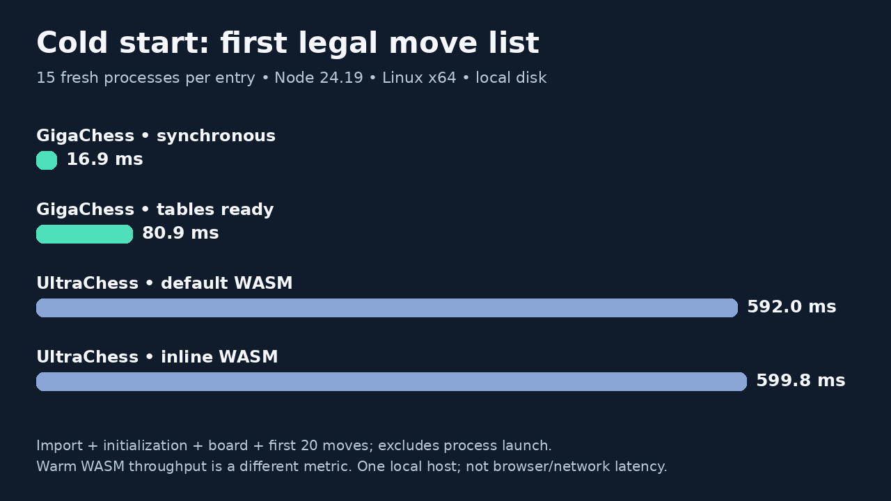

# GigaChess 0.6.0 benchmark report

## Pure-JS comparison

Ratio = GigaChess throughput / competitor throughput. Ranges across Linux x64 (Node 22.5, 24.19), Linux ARM64, Windows x64 and Windows ARM64 (Node 24.19). Higher is better. The tested candidate uses the bundled `gigachess/fast` entry with loaded sliding and Zobrist tables. Native list types differ, so normalized UCI and SAN lanes are reported separately. No cached move-list reuse.

| Workload | drumevp 1.3.2 | drumevp source | chessops 0.15.1 | chess.js 1.4.0 | GigaChess 0.5.0 |
|---|---:|---:|---:|---:|---:|
| Native move list | 2.83–3.65× | 2.79–4.06× | 5.09–6.39× | 1,706.09–2,434.72× | 3.45–4.43× |
| Normalized UCI list | 1.43–1.64× | 1.35–1.68× | 1.69–1.82× | 309.80–375.14× | 1.49–1.56× |
| SAN list | — | — | 2.72–3.08× | 7.44–8.09× | 1.28–1.34× |
| FEN round trip | 1.56–1.82× | — | 3.00–3.80× | 4.34–6.27× | 1.51–1.62× |
| Validated UCI replay | 5.22–6.35× | — | 3.70–5.03× | 358.57–512.92× | 4.71–5.38× |
| Start perft d5 | 1.80–2.22× | 1.81–2.21× | 9.57–13.36× | 79.75–103.85× | 4.26–5.94× |
| Kiwipete perft d4 | 1.76–2.06× | 1.75–2.06× | 9.11–11.62× | 103.78–128.28× | 4.75–6.17× |
| Endgame perft d5 | 1.35–1.64× | 1.37–1.61× | 7.60–10.11× | 45.86–61.46× | 4.79–7.15× |
| Promotion perft d4 | 1.64–1.95× | 1.65–1.95× | 8.71–11.95× | 90.96–119.69× | 4.39–6.14× |
| Mixed perft d3 | 1.66–1.93× | 1.63–1.92× | 7.83–9.87× | 132.10–164.40× | 3.57–4.63× |

— means unsupported/not measured, not zero throughput. Source drumevp is pinned to `0bfd032c197dde4dddfcf0810f036cdf78bb8b45`. The large chess.js native/UCI ratios include its expensive verbose move objects and metadata; they are not comparable to a raw packed-array microbenchmark. The separate original direct 4k comparison against published drumevp is 2.33–3.73×; the unprimed arbitrary-FEN comparison is 2.34–3.66×.

## UltraChess (Rust/WebAssembly), separate category

| Warm workload | GigaChess / UltraChess 1.4.0 |
|---|---:|
| Native move list | 0.46–0.62× |
| Normalized UCI list | 0.81–0.87× |
| SAN list | 0.37–0.54× |
| FEN round trip | 0.62–0.74× |
| Validated UCI replay | 1.17–1.67× |
| Start perft d5 | 0.20–0.41× |
| Kiwipete perft d4 | 0.17–0.29× |
| Endgame perft d5 | 0.22–0.27× |
| Promotion perft d4 | 0.23–0.37× |
| Mixed perft d3 | 0.18–0.31× |

Below 1× means UltraChess is faster. Its warm perft and move-generation throughput are excellent; GigaChess leads validated replay on these runs. The two runtimes have distinct initialization and deployment costs.

### First-use latency

| Entry | Median import (ms) | Median import through first legal list (ms) |
|---|---:|---:|
| GigaChess fast, synchronous fallback | 13.4 | 16.9 |
| GigaChess fast, tables + hash loaded | 13.4 | 80.9 |
| UltraChess default, async create | 4.0 | 592.0 |
| UltraChess inline, sync create | 10.2 | 599.8 |

15 independent fresh Node 24.19 processes per entry, counterbalanced, Intel Xeon E5-1620 v2 (Linux x64), local filesystem, process launch excluded. Both engines produced exactly 20 legal moves. GigaChess synchronous fallback is usable without awaiting tables; the fully loaded comparison includes both sliding and hash initialization. The measured UltraChess first-use cost is not a universal browser/network latency or a defect in chess correctness. Warm results exclude initialization.

## Reproduction and limitations

- [Final raw artifacts and summary](../bench/results/js-phase22-final/summary.json) and [selection report](../bench/results/js-phase22-final-2026-11-26.md).
- [Original validation](https://github.com/itshak/gigachess/actions/runs/45721285801) and [successful Node 22 retry](https://github.com/itshak/gigachess/actions/runs/45727896633).
- [Pinned reproduction scripts](https://github.com/itshak/gigachess/tree/e81b3fcb0a4581ac080d917620f9f53561d94fc5/bench/phase22); [cold samples](../bench/results/cold-start-0.6.0.json), run `node bench/cold-start.mjs --measure` after building.
- Each matrix uses 20,000 positions and 300 validated games; exact move sets (579,975 moves), 348,148 ordered SAN/UCI strings on 12,000 positions, perft checks and full correctness suites.
- Relative to Phase15, EarlySAN increases direct generation 2.71–4.06×, replay 12.8–22.2%, and start construction 7.35–10.78×; FEN roundtrip is 3.2–6.6% slower and deep perft up to 5.2% slower. No claim that every internal metric improved.
- Final macOS/Apple Silicon and browser comparisons are deferred. Results demonstrate leadership over the tested pure-JS implementations and configurations, not a universal fastest-library claim.
- No competitor runtime code copied; GPL chessops used solely as a test/benchmark oracle. See [third-party notices](../THIRD_PARTY_NOTICES.md).
